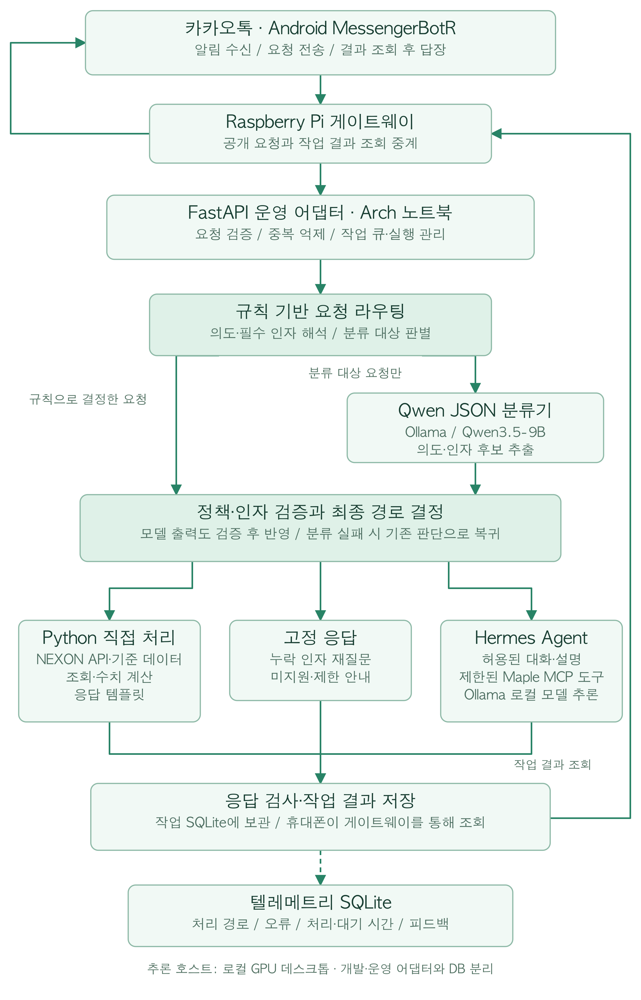

# Skylark Rita — Technical Overview

> Runtime source code and credentials are kept in a private repository for operational and API security.

## Hybrid Routing Architecture

  

- **Ingress & Gateway**: KakaoTalk (Android MessengerBotR) → Raspberry Pi Gateway → FastAPI Operations Adapter (request validation, deduplication, job queue)
- **Hybrid Routing & Validation**:
  1. Deterministic Python routing & templates for clear lookup/calculation queries (**20+ tools**)
  2. Local sLLM JSON classifier (Ollama) for ambiguous natural-language intent & minimal argument extraction
  3. Policy & argument verification layer before execution (reverts safely on invalid outputs)
- **Execution Paths**: Direct Python / NEXON Open API execution · Fixed clarification responses · MCP-based local LLM agent (`Hermes Agent`)
- **Telemetry**: SQLite job & telemetry store (routing path, errors, processing/queue latency, feedback)

## 1st Beta Telemetry & Evaluation Notes

- As of November 8, 2026, Rita had logged 791 production requests, of which 32 were recorded as errors.
- **109 ms** median latency across **236** direct-routed queries (bypassing LLM calls)
- **~200** deduplicated real user queries audited to diagnose silent failures (execution success vs. user-perceived task failure), argument extraction edge cases, external API maintenance propagation, and persona consistency
